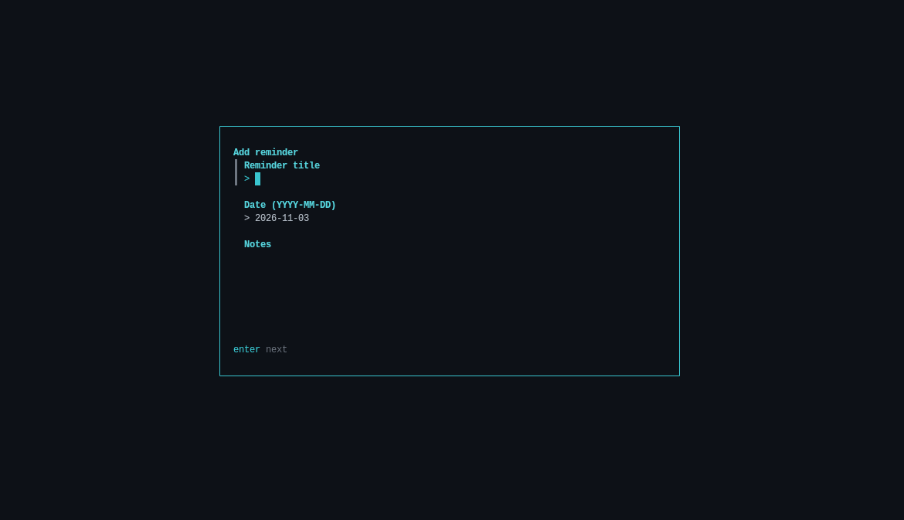
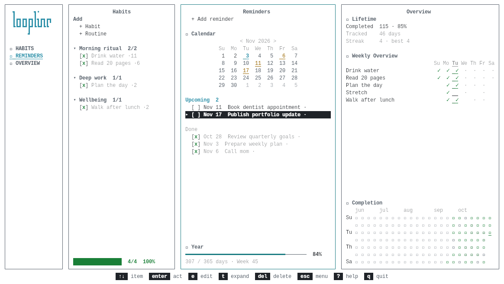
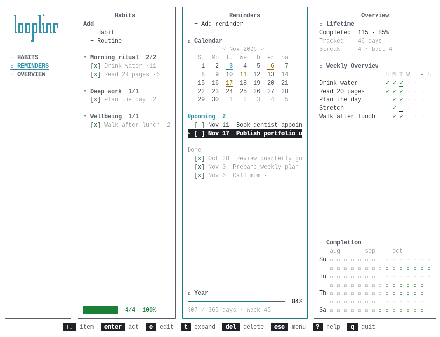
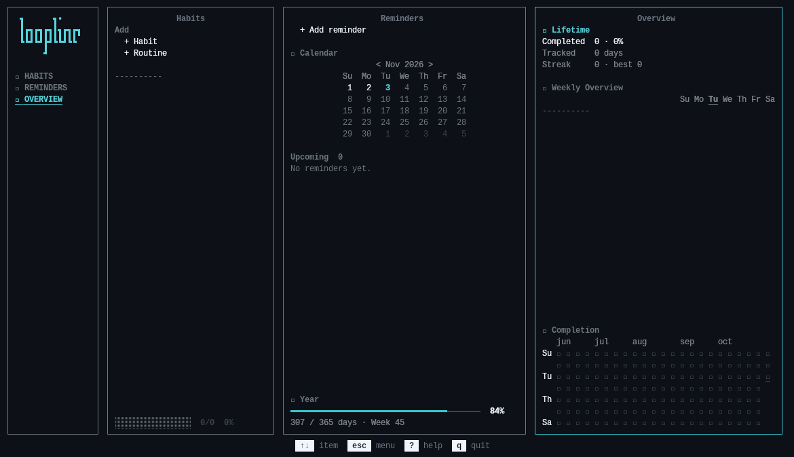
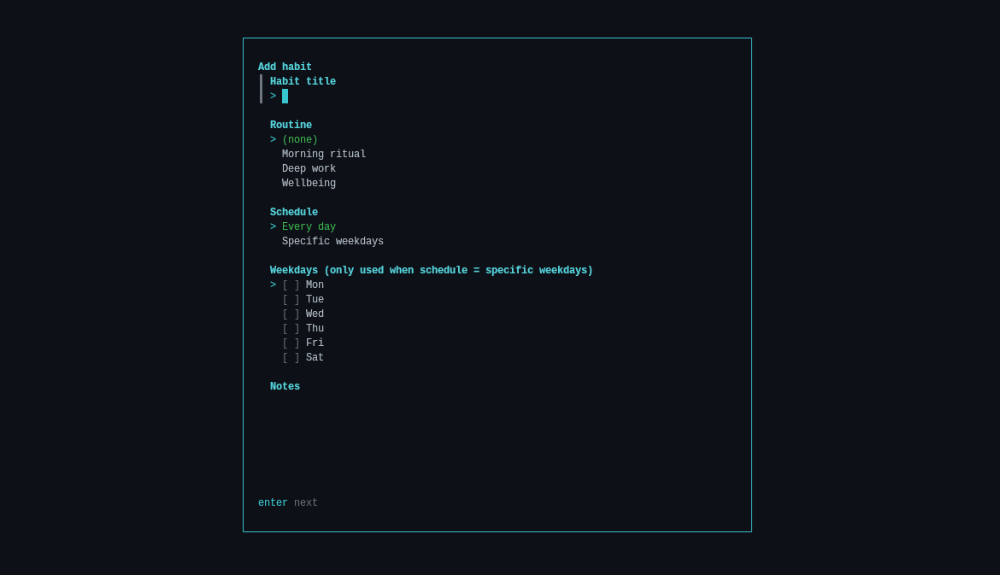
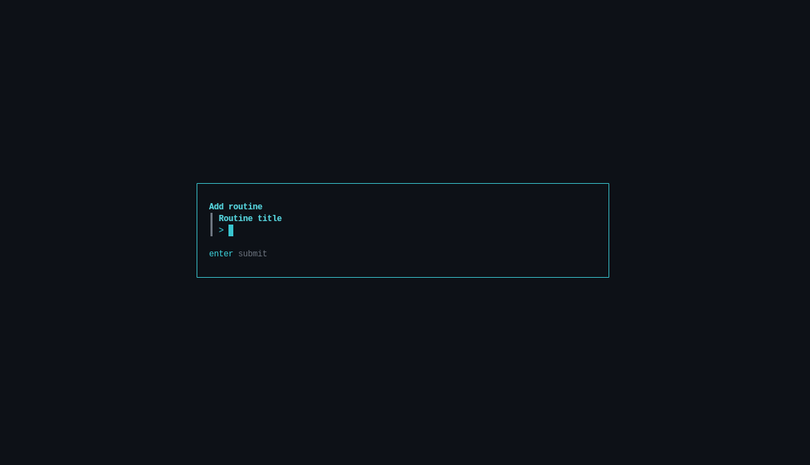
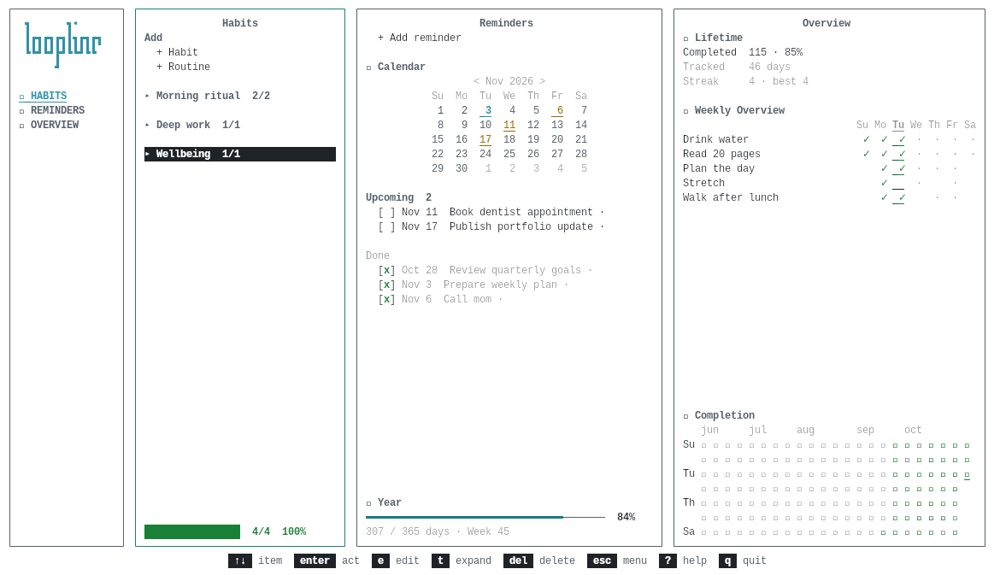

# loopline

> A keyboard-first terminal dashboard for habits, routines, reminders, and
> completion history.

`loopline` is a local-first TUI for turning recurring tasks into a calm daily
workflow. It runs entirely in the terminal, keeps data in a single SQLite
database, and works without an account, network connection, or background
service.

## Why loopline?

Most habit trackers optimize for notifications and dashboards in the browser.
`loopline` takes a different approach: keep the data private, make the common
actions fast, and let the terminal stay in the flow.

The interface is organized into three panels:

- **Habits** — manage daily or weekday-based habits, optionally grouped into
  routines.
- **Reminders** — keep dated one-off notes and mark them complete.
- **Overview** — review lifetime progress, the current week, streaks, and a
  completion heatmap.

## Preview

The demo data set makes it easy to explore a populated dashboard without
touching your personal database:



The layout also adapts to light terminal themes:



### Core workflows

<p align="center">
  
  
</p>

### Add flows

<p align="center">
  
  
  
</p>

## Highlights

- Keyboard-first navigation with a responsive three-panel layout.
- Local SQLite persistence with automatic migrations.
- Daily and weekday schedules, routines, archiving, and completion history.
- Current and best streak calculations derived from completion data.
- Calendar navigation and year progress for reminders.
- Modal create, edit, and destructive-confirmation flows.
- ANSI-16 styling that adapts to the user's terminal theme.
- Pure-Go SQLite driver, so no CGo setup is required.

## Requirements

- Go **1.26.5**
- A terminal with at least **96 × 33** cells for the full layout

At 120 columns and wider, `loopline` adds an identity/navigation rail. Smaller
terminals use a compact header; terminals below the minimum size show a clear
resize message instead of clipping the interface.

## Install and run

Clone the repository and run the application directly:

```sh
git clone https://github.com/ely-id/loopline.git
cd loopline
go run ./cmd/loopline
```

To build a standalone binary:

```sh
go build -o loopline ./cmd/loopline
./loopline
```

By default, data is stored at:

```text
$XDG_DATA_HOME/loopline/loopline.db
```

When `XDG_DATA_HOME` is not set, `~/.local/share/loopline/loopline.db` is used.
For a disposable database, pass an explicit path:

```sh
go run ./cmd/loopline --db /tmp/loopline-demo.db
```

For screenshots or a portfolio walkthrough, seed a disposable database with
sample routines, habits, reminders, and 45 days of varied completion history:

```sh
go run ./cmd/loopline --demo --db /tmp/loopline-portfolio.db
```

The `--demo` flag only accepts an empty database, so it cannot silently append
duplicates to an existing personal database. Delete the temporary database and
run the command again whenever a fresh demonstration is needed.

## Controls

| Key | Action |
| --- | --- |
| `Tab` / `Shift+Tab` | Move between panels |
| `Enter` | Enter a panel, activate an action, or toggle completion |
| `Up` / `Down` or `j` / `k` | Move through the focused panel |
| `e` | Edit the selected habit, routine, or reminder |
| `t` | Expand or collapse a routine or reminder |
| `Delete` | Delete the selected entity after confirmation |
| `Left` / `Right` | Browse older or newer completion history |
| `<` / `>` or `[` / `]` | Browse calendar months |
| `Esc` | Close a modal/help view or return to panel navigation |
| `?` | Open help |
| `q` | Quit |

## Architecture

The codebase is intentionally small and layered:

```text
cmd/loopline
    ├── internal/ui       Bubble Tea TUI and interaction state
    ├── internal/app      application services and ports
    ├── internal/domain   pure scheduling and statistics logic
    ├── internal/store    SQLite persistence and migrations
    └── internal/theme    ANSI-16 visual system
```

The UI never accesses SQLite directly. The application service owns behavior,
the domain package stays pure, and the store provides the persistence boundary.
See [`docs/ARCHITECTURE.md`](docs/ARCHITECTURE.md) for the full contract and
[`docs/QA.md`](docs/QA.md) for the current conformance report.

## How it was built

`loopline` started as a study in coordinating a small team of coding agents,
and the architecture document doubles as the team's contract. Four roles share
the codebase:

| Role | Owns |
| --- | --- |
| **lead** | `internal/app`, `cmd/loopline`, `docs/`, and `go.mod` |
| **data** | `internal/domain` and `internal/store` |
| **ui** | `internal/ui` and `internal/theme` |
| **qa** | Test files prefixed `spec_`, plus the `app` and `cmd` tests |

A few rules keep the roles from colliding:

- **One owner per file.** No role edits a file it does not own.
- **Frozen signatures.** `domain/date.go` and `domain/model.go` were seeded by
  the lead, and their exported signatures change only with the lead's approval.
- **Separate test namespaces.** `data` and `ui` write unit tests with plain
  names. `qa` only creates files prefixed `spec_`, so two roles never write the
  same file.
- **A fixed dependency set.** No role adds a dependency on its own.

[`scripts/codex-review`](scripts/codex-review) gives the lead a second opinion:
it asks a separate model for a read-only review and returns the recommendations
without modifying files. [`docs/QA.md`](docs/QA.md) records the result of the
`qa` pass as a requirement-by-requirement table with the test that proves each
line.

## Development

Run the standard checks:

```sh
go fmt ./...
go test ./...
go vet ./...
go build ./cmd/loopline
```

The test suite has 251 test functions in 34 files, more lines than the
application code itself. It covers domain rules, persistence, CRUD flows,
navigation, responsive rendering, terminal sizing, calendar behavior, and
completion statistics.

## Project status

`loopline` is an actively evolving portfolio project. The current focus is
polishing the terminal experience while keeping the core model and persistence
rules explicit, testable, and easy to extend.

## License

This project is released under the [MIT License](LICENSE). It permits copying,
modification, and redistribution, including in commercial projects, as long as
the copyright and license notice are preserved.
